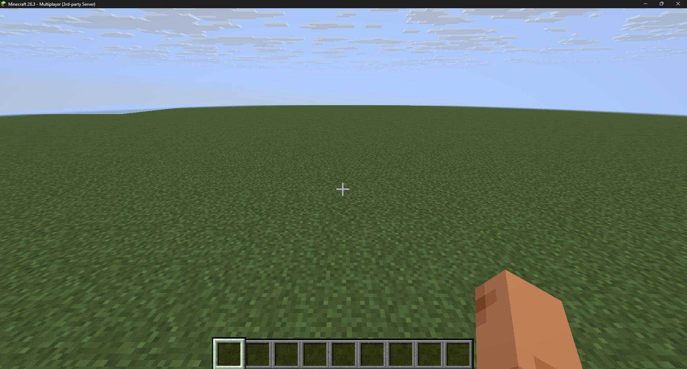
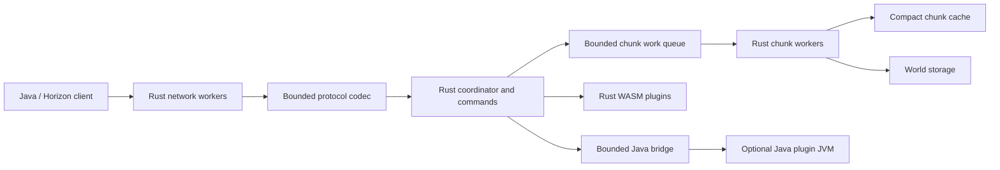

# Zerqon

[Русский](README.ru.md) · [Configuration](docs/CONFIGURATION.md) · [Rust plugins](docs/RUST_PLUGINS.md) · [Java plugins](docs/JAVA_PLUGINS.md)

Zerqon is a Minecraft Java Edition **26.3** server core written from scratch in Rust by **teighto**. It uses a multithreaded network runtime and a bounded worker pool for chunk generation, encoding and storage. Its own plugin API supports Rust plugins compiled to WebAssembly and Java plugins in an optional JVM process.

**0.0.1 is in development and has not been published as a finished release.** The current code is not a production replacement for Paper. Full survival gameplay, vanilla world generation, Paper API compatibility and integrated spark are unfinished. Java and Horizon client compatibility must be assessed against the tested scenarios; protocol support alone does not establish complete gameplay compatibility.

## Current scope

- Minecraft 26.3 / protocol 777: status, login/configuration, registry synchronization, chunk delivery, movement and commands.
- Compact chunk storage, bounded cache and work queues, concurrent chunk work, persistent block changes.
- Console and in-game diagnostics: `/version`, `/tps`, `/tpsbar`, `/plugins`; operator commands and graceful shutdown.
- Rust WASM plugin sandbox with instruction, memory and message limits; Java plugin SDK with lifecycle and command events.
- `server.properties` plus validated `server.settings`, native executable and optional `java -jar zerqon.jar` launcher.

The current world is a flat development world with a custom storage format. It is not an Anvil/Paper world importer. Tick timing reports coordinator work; they are not a complete CPU profile of all worker threads. No performance advantage over Paper is claimed without a comparable workload measurement.



Actual Minecraft 26.3 client screenshot from the flat-world connection check. It demonstrates world display, not complete vanilla gameplay.

## Measured performance

Local measurement: AMD Ryzen 9 9900X, Windows 11, Rust 1.97 release build, 10,000 flat chunks; median of three runs on 7 November 2026.

| Test | Result |
|---|---:|
| Generation, one thread | 22,787 chunks/s |
| Generation, four workers | 64,288 chunks/s |
| Chunk decoding | 115,524 chunks/s |
| Flat chunk: structure + section allocations | 2,920 bytes |
| Saved flat chunk | 1,790 bytes |

This is a synthetic chunk benchmark. It excludes gameplay, networking, allocator overhead and total process memory; it is not a Paper comparison or a player-capacity estimate.

```sh
cargo run -p zerqon-world --example world_bench --release --locked -- 10000 4
```

## Run a local distribution

Build a local distribution using the commands below and extract its archive into an empty server directory. A public 0.0.1 release is reserved for the completed acceptance checks. Python 3.11+ and Java 25 are needed to prepare official version data. Java is also needed for the JAR launcher and Java plugins; the native Rust server does not run the Java game engine.

Linux:

```sh
chmod +x zerqon
./zerqon --init
python3 scripts/prepare-data.py
```

Windows PowerShell:

```powershell
.\zerqon.exe --init
python scripts/prepare-data.py
```

Read the [Minecraft EULA](https://aka.ms/MinecraftEULA), then set `eula=true` in `eula.txt` if you agree. Review `server.properties`; the default listener is `127.0.0.1:25565` and `online-mode=true`.

Start with `./zerqon --nogui` on Linux or `.\zerqon.exe --nogui` on Windows. The equivalent launcher command is:

```sh
java -Xms16M -Xmx64M -jar zerqon.jar --nogui
```

`-Xmx` here limits the small launcher JVM, not the Rust server or plugin host. Configure Rust thread and cache limits in `server.settings`. To listen externally, set `server-ip=0.0.0.0` explicitly. Keep online authentication enabled for an externally reachable server.

The preparation script downloads the pinned official 26.3 server JAR, verifies its hash and generates local protocol data. Minecraft files are not included in Zerqon release archives. An existing official JAR can be supplied with `--server-jar PATH`.

Use `stop` in the console for shutdown. CLI flags and each configuration setting are documented in [Configuration](docs/CONFIGURATION.md).

## Plugins

```text
plugins/
├── rust-plugins/   # Rust .wasm plugins
└── java-plugins/   # Java .jar plugins
```

Distribution examples are under `examples/`, and are not enabled automatically. Copy `examples/rust-plugins/hello.wasm` into `plugins/rust-plugins/` for `/hello`, or `examples/java-plugins/hello.jar` into `plugins/java-plugins/` for `/jhello`. Restart to load them.

Both APIs currently provide lifecycle, commands, logging, tick and player notifications. World, inventory and entity mutation APIs are still planned. Java plugins target Zerqon's own API; [Paper compatibility](docs/JAVA_COMPATIBILITY.md) is a separate unfinished layer. The Java host uses the JARs in `libraries/` and starts only when enabled and Java plugin files are present.

See [Rust plugin development](docs/RUST_PLUGINS.md) and [Java plugin development](docs/JAVA_PLUGINS.md). A command sender's kind is explicit; a player named `CONSOLE` does not acquire console privileges.

## Architecture



Network and chunk processing use multiple threads. Plugin callbacks are serialized within their hosts. A complete region-parallel gameplay simulation is still part of the [implementation plan](docs/ROADMAP.md).

Planned user-facing work also includes configurable client admission and the player TAB list. These are not included in the implemented feature list above.

## Build and test

Use Rust **1.97**, JDK **25**, Python **3.11+**, Git and the platform's native build tools. Windows needs Visual Studio C++ Build Tools and CMake; Linux needs a C/C++ compiler, CMake and Make/Ninja for cryptographic dependencies.

```sh
rustup target add wasm32-unknown-unknown
cargo test --workspace --locked
cargo clippy --workspace --all-targets --locked -- -D warnings
cargo build -p zerqon --release --locked
cargo build -p zerqon-hello-plugin --target wasm32-unknown-unknown --release --locked
python scripts/build-java-plugins.py
```

Build the launcher with `sh scripts/build-launcher.sh` on Linux or `powershell -File scripts/build-launcher.ps1` on Windows. Run the data-dependent checks after preparing the official data:

```sh
python scripts/prepare-data.py
cargo test --workspace --locked -- --ignored
python scripts/test-vanilla-codec.py
python -m unittest discover -s scripts -p "test_*.py"
```

These checks include protocol fixtures, network rejection scenarios, storage, plugin execution and decoding generated packets with official Minecraft codecs. They do not replace graphical client checks, authenticated account tests or a production soak test.

`python scripts/package-release.py` builds and checks a distribution. Its archive allowlist excludes worlds, configs, credentials, downloaded game data and caches. `--skip-build` packages existing artifacts after separate verification. CI builds Windows and Linux independently; release artifacts include checksums and third-party notices.

## License

Zerqon is licensed under [GPL-3.0-only](LICENSE). Project author: **teighto**. Dependency copyright and license notices are preserved separately in release archives. Minecraft is a trademark of Mojang Studios; this is an independent project.
