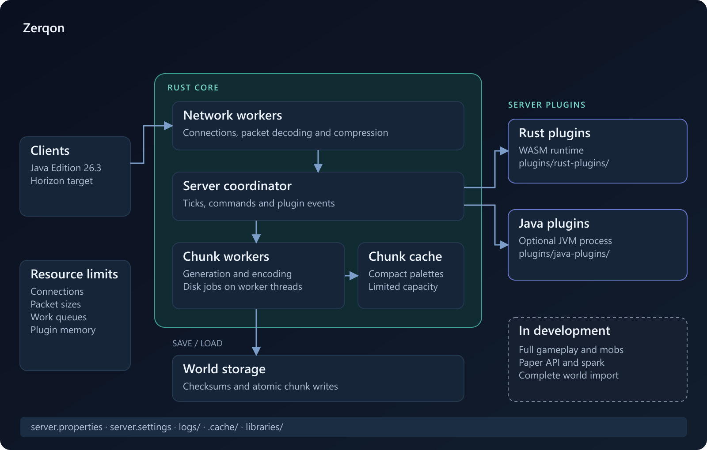
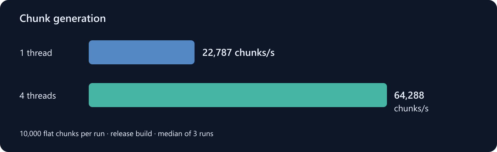
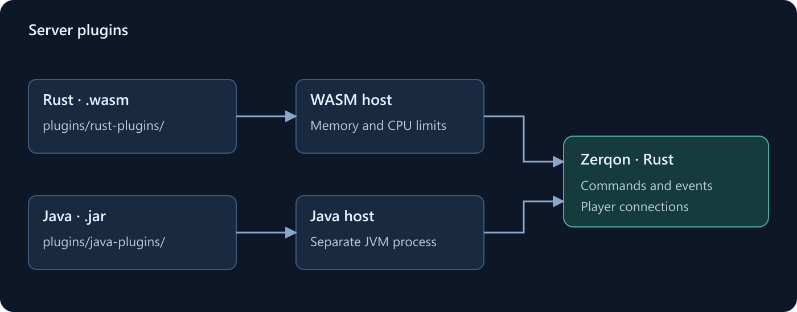

# Zerqon

[English](#english) · [Русский](#russian) · [Настройки / Configuration](docs/CONFIGURATION.md)



<a id="english"></a>
## English

Zerqon is a Minecraft 26.3 server written in Rust by teighto. The project focuses on memory use and splitting server work across CPU cores. Plugins can be written in Java or Rust.

The server keeps the familiar folder layout: worlds, logs, configuration files and a plugins folder. Java and Rust plugins can run on the same server, while players connect with their usual client.

Version 0.0.1 is in development. A Java client can enter the test world, and the Java and Rust example plugins run. Full gameplay, Paper compatibility and spark are still being implemented.

### Paper and Zerqon

| | Paper | Zerqon |
|---|---|---|
| Server engine | Java, running on the JVM | Native Rust executable |
| Plugins | Bukkit, Spigot and Paper Java plugins | Own Java and Rust APIs; Paper support in development |
| Java runtime | Required for the server | Used for Java plugins and initial game-data preparation |
| Worlds | Vanilla world storage | Own storage; world import is being developed |
| Availability | Published server releases | 0.0.1 is not released yet |

Paper details: [PaperMC documentation](https://docs.papermc.io/paper/). A speed or RAM comparison between the two servers needs the same world and workload; that comparison has not been run yet.

### Performance



Ryzen 9 9900X, Windows 11, Rust 1.97 release build. Median of three runs with 10,000 flat chunks on 7 November 2026.

| Test | Result |
|---|---:|
| Generate chunks on one thread | 22,787 chunks/s |
| Generate chunks with four workers | 64,288 chunks/s |
| Decode saved chunks | 115,524 chunks/s |

One flat chunk uses 2,920 bytes for its structure and section allocations; its saved file is 1,790 bytes. These figures exclude allocator overhead and total process memory. The test measures chunk processing, not gameplay or player capacity.

```sh
cargo run -p zerqon-world --example world_bench --release --locked -- 10000 4
```

### Start the server

Use Rust 1.97, Python 3.11+ and JDK 25. Java is needed to prepare Minecraft's data and to run Java plugins. The game engine runs in Rust.

```sh
cargo run --release -- --init
python scripts/prepare-data.py
```

Read the [Minecraft EULA](https://aka.ms/MinecraftEULA) and set `eula=true` in `eula.txt` if you agree. Set the port in `server.properties` and the thread counts in `server.settings`. Then start:

```sh
cargo run --release
```

For a server without the Rust toolchain, build once with `cargo build --release` and run `target/release/zerqon` (`zerqon.exe` on Windows). There is no core JAR. Type `stop` in the console to shut down.

### Settings and plugins



```text
server.properties
server.settings
eula.txt
plugins/
  rust-plugins/
  java-plugins/
libraries/
.cache/
logs/
world/
```

`server.properties` contains the address, port, MOTD and Minecraft settings. `server.settings` contains thread counts, cache limits and plugin settings. Start with the defaults, then adjust the values for your server.

Put Rust `.wasm` plugins in `plugins/rust-plugins/` and Java `.jar` plugins in `plugins/java-plugins/`. Java plugins currently use Zerqon's own API. Players do not need to install them.

[Configuration](docs/CONFIGURATION.md) · [Rust plugin development](docs/RUST_PLUGINS.md) · [Java plugin development](docs/JAVA_PLUGINS.md) · [Paper compatibility](docs/JAVA_COMPATIBILITY.md)

<a id="russian"></a>
## Русский

Zerqon, сервер Minecraft 26.3 на Rust от teighto. Работа над ядром сосредоточена на расходе памяти и распределении нагрузки между ядрами процессора. Плагины можно писать на Java и Rust.

Папки остаются привычными: миры, логи, настройки и плагины. На одном сервере можно использовать Java- и Rust-плагины. Игроки подключаются обычным клиентом.

Версия 0.0.1 в разработке. Java-клиент уже заходит в тестовый мир, примеры Java- и Rust-плагинов работают. Полный игровой процесс, совместимость с Paper и spark ещё разрабатываются.

### Paper и Zerqon

| | Paper | Zerqon |
|---|---|---|
| Движок сервера | Java, работает в JVM | Нативный исполняемый файл Rust |
| Плагины | Java-плагины Bukkit, Spigot и Paper | Собственные API Java и Rust; поддержка Paper в разработке |
| Java | Нужна для работы сервера | Нужна Java-плагинам и для первоначальной подготовки игровых данных |
| Миры | Формат хранения vanilla | Собственное хранение; импорт миров разрабатывается |
| Выпуск | Есть опубликованные релизы | 0.0.1 пока не выпущена |

Сведения о Paper: [документация PaperMC](https://docs.papermc.io/paper/). Сравнение скорости и памяти требует одинакового мира и нагрузки. Такого замера пока нет.

### Производительность

Ryzen 9 9900X, Windows 11, Rust 1.97, release-сборка. Медиана трёх запусков по 10 000 плоских чанков, 7 ноября 2026 года.

| Тест | Результат |
|---|---:|
| Генерация в один поток | 22 787 чанков/с |
| Генерация в четыре потока | 64 288 чанков/с |
| Чтение сохранённых чанков | 115 524 чанков/с |

Структура плоского чанка и выделенная память секций занимают 2 920 байт, файл чанка на диске занимает 1 790 байт. Накладные расходы аллокатора и остальная память процесса сюда не входят. Это замер обработки чанков; по нему нельзя определить количество игроков на сервере.

```sh
cargo run -p zerqon-world --example world_bench --release --locked -- 10000 4
```

### Запуск

Нужны Rust 1.97, Python 3.11+ и JDK 25. Java используется для подготовки данных Minecraft и Java-плагинов. Игровой движок работает на Rust.

```sh
cargo run --release -- --init
python scripts/prepare-data.py
```

Прочитайте [Minecraft EULA](https://aka.ms/MinecraftEULA) и при согласии установите `eula=true` в `eula.txt`. Порт задаётся в `server.properties`, количество потоков в `server.settings`. Обычный запуск:

```sh
cargo run --release
```

Для запуска без Cargo и установленного Rust сначала выполните `cargo build --release`, затем запускайте `target/release/zerqon` или `zerqon.exe` на Windows. JAR-версии ядра нет. Для остановки введите `stop` в консоли.

### Настройки и плагины

Адрес, порт, MOTD и настройки Minecraft находятся в `server.properties`. Потоки, кеш и настройки плагинов находятся в `server.settings`. Все значения по умолчанию создаются при первом запуске.

Rust-плагины `.wasm` кладутся в `plugins/rust-plugins/`, Java-плагины `.jar` в `plugins/java-plugins/`. Сейчас Java-плагины используют собственный API Zerqon. Игрокам устанавливать плагины не нужно.

[Настройки](docs/CONFIGURATION.md) · [Разработка на Rust](docs/RUST_PLUGINS.md) · [Разработка на Java](docs/JAVA_PLUGINS.md) · [Совместимость с Paper](docs/JAVA_COMPATIBILITY.md)

## License / Лицензия

[GPL-3.0](LICENSE). Автор: [teighto](https://github.com/teighto).
