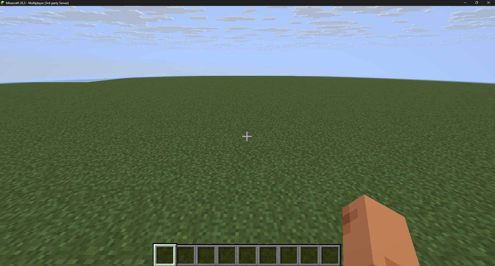
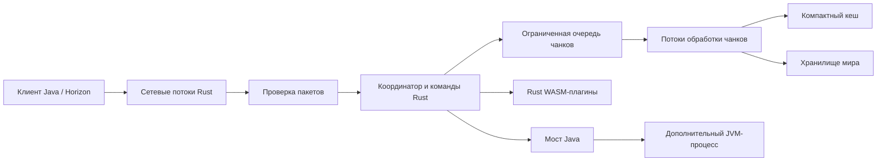

# Zerqon

[English](README.md) · [Конфигурация](docs/CONFIGURATION.md) · [Rust-плагины](docs/RUST_PLUGINS.md) · [Java-плагины](docs/JAVA_PLUGINS.md)

Zerqon — серверное ядро **Minecraft Java Edition 26.3**, написанное с нуля на Rust. Автор — **teighto**. Сеть работает в многопоточном runtime, обработка чанков — в отдельном пуле потоков с ограниченной очередью. Собственный API поддерживает Rust-плагины WebAssembly и Java-плагины в дополнительном процессе JVM.

**0.0.1 находится в разработке и ещё не опубликована как завершённый релиз.** Текущий код пока не заменяет Paper на рабочем сервере: полный survival, генерация vanilla, совместимость Paper API и встроенный spark не завершены. Поддержка протокола не означает, что все игровые сценарии Java-клиента и Horizon уже проверены.

## Реализуемая основа

- Сеть Minecraft 26.3 / протокол 777: статус, вход и конфигурация, реестры, чанки, перемещение и команды.
- Компактное хранение чанков, ограниченные кеш и очереди, параллельная обработка и сохранение изменений блоков.
- Консоль и команды `/version`, `/tps`, `/tpsbar`, `/plugins`, операторские команды и завершение работы.
- Rust WASM-плагины с ограничением инструкций, памяти и сообщений; собственный Java SDK.
- `server.properties`, проверяемый `server.settings`, нативный файл и запускатор `zerqon.jar`.

Сейчас используется плоский тестовый мир и собственный формат хранения. Импорт миров Anvil/Paper не реализован. Метрика времени тика измеряет работу координатора, а не все потоки процесса. Преимущество в скорости или памяти перед Paper без сопоставимого измерения не заявляется.



Настоящий скриншот проверки подключения Minecraft 26.3. Он подтверждает отображение мира, а не полную реализацию игрового процесса vanilla.

## Измеренная производительность

Локальный замер: AMD Ryzen 9 9900X, Windows 11, Rust 1.97, release-сборка, 10 000 плоских чанков. Медиана трёх запусков 7 ноября 2026 года.

| Тест | Результат |
|---|---:|
| Генерация, один поток | 22,787 чанков/с |
| Генерация, четыре потока | 64,288 чанков/с |
| Декодирование чанков | 115,524 чанков/с |
| Плоский чанк: структура + память секций | 2,920 байт |
| Сохранённый плоский чанк | 1,790 байт |

Это синтетический тест чанков. В него не входят игровой процесс, сеть, накладные расходы аллокатора и вся память процесса. Он не является сравнением с Paper или оценкой вместимости сервера.

```sh
cargo run -p zerqon-world --example world_bench --release --locked -- 10000 4
```

## Запуск локальной сборки

Соберите локальный дистрибутив командами ниже и распакуйте архив в пустую папку сервера. Публикация версии 0.0.1 выполняется только после завершения необходимых проверок. Для подготовки официальных данных нужны Python 3.11+ и Java 25. Java также нужна запускатору и Java-плагинам; сам Rust-сервер не запускает Java-движок игры.

Linux:

```sh
chmod +x zerqon
./zerqon --init
python3 scripts/prepare-data.py
```

Windows PowerShell:

```powershell
.\zerqon.exe --init
python scripts/prepare-data.py
```

Прочитайте [Minecraft EULA](https://aka.ms/MinecraftEULA) и при согласии установите `eula=true` в `eula.txt`. По умолчанию сервер слушает `127.0.0.1:25565`, `online-mode=true`.

Запуск: `./zerqon --nogui` на Linux или `.\zerqon.exe --nogui` на Windows. Через JAR:

```sh
java -Xms16M -Xmx64M -jar zerqon.jar --nogui
```

Флаг `-Xmx` ограничивает только небольшой JVM-запускатор. Параметры потоков и кеша Rust задаются в `server.settings`. Для внешних подключений явно укажите `server-ip=0.0.0.0`; оставьте проверку аккаунтов включённой.

Скрипт подготовки загружает закреплённую версию официального JAR, проверяет хеш и создаёт локальные данные протокола. Файлы Minecraft в архив Zerqon не входят. Свой официальный JAR можно передать через `--server-jar PATH`.

Для остановки введите `stop`. Все флаги и настройки — в [документации конфигурации](docs/CONFIGURATION.md).

## Плагины

```text
plugins/
├── rust-plugins/   # плагины Rust .wasm
└── java-plugins/   # плагины Java .jar
```

Примеры из `examples/` не включаются автоматически. Скопируйте `examples/rust-plugins/hello.wasm` в `plugins/rust-plugins/` для `/hello` или `examples/java-plugins/hello.jar` в `plugins/java-plugins/` для `/jhello`, затем перезапустите сервер.

В обоих API доступны жизненный цикл, команды, журнал, события тиков и игроков. API изменения мира, инвентарей и сущностей ещё планируется. Java-плагины используют собственный API Zerqon; [совместимость Paper](docs/JAVA_COMPATIBILITY.md) разрабатывается отдельно. JVM-хост запускается только при включённой настройке и наличии Java-плагинов.

Инструкции: [Rust](docs/RUST_PLUGINS.md) и [Java](docs/JAVA_PLUGINS.md). Тип отправителя команды передаётся явно: игрок с ником `CONSOLE` не получает права консоли.

## Архитектура



Сеть и чанки обрабатываются в нескольких потоках. Вызовы плагинов последовательны внутри каждого хоста. Полная региональная многопоточность игровой симуляции остаётся в [плане](docs/ROADMAP.md).

Также запланированы настройка допуска клиентов и список игроков TAB. Они пока не входят в перечисленные выше реализованные возможности.

## Сборка и проверки

Нужны Rust **1.97**, JDK **25**, Python **3.11+**, Git и средства нативной сборки. На Windows — Visual Studio C++ Build Tools и CMake; на Linux — C/C++-компилятор, CMake и Make/Ninja.

```sh
rustup target add wasm32-unknown-unknown
cargo test --workspace --locked
cargo clippy --workspace --all-targets --locked -- -D warnings
cargo build -p zerqon --release --locked
cargo build -p zerqon-hello-plugin --target wasm32-unknown-unknown --release --locked
python scripts/build-java-plugins.py
```

Запускатор: `sh scripts/build-launcher.sh` на Linux или `powershell -File scripts/build-launcher.ps1` на Windows. Проверки с официальными данными:

```sh
python scripts/prepare-data.py
cargo test --workspace --locked -- --ignored
python scripts/test-vanilla-codec.py
python -m unittest discover -s scripts -p "test_*.py"
```

Тесты проверяют пакеты, отказ на некорректный сетевой ввод, хранение, исполнение плагинов и декодирование официальными кодеками Minecraft. Они не заменяют проверку графическими клиентами, реальным аккаунтом и длительной нагрузкой.

`python scripts/package-release.py` собирает и проверяет дистрибутив. В архив попадают только явно перечисленные файлы: без миров, пользовательских конфигов, секретов, кешей и данных Minecraft. `--skip-build` использует ранее собранные и отдельно проверенные артефакты. CI собирает Windows и Linux отдельно; архивы включают контрольные суммы и лицензии зависимостей.

## Лицензия

[GPL-3.0-only](LICENSE). Автор проекта — **teighto**. Уведомления об авторских правах зависимостей сохраняются отдельно в дистрибутиве. Minecraft принадлежит Mojang Studios; Zerqon — независимый проект.
